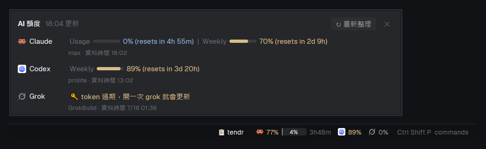

# herdr-quota

English ｜ [繁體中文](README.md)

A layout for the [herdr app](https://herdr.dev): the bottom status bar shows, at its right end, how much of your Claude, Codex and Grok plans is left.



- **Weekly limit**: the brand logo followed by the percentage (yellow from 70 %, red from 90 %, plus the days until reset when it's nearly used up)
- **5-hour limit** (only Claude has one today): a small bar with the percentage inside, followed by the time until it resets
- **Click** for a popup with a bar per limit, exact reset times, the plan and how fresh the data is, and a refresh button
- With [tendr](https://github.com/ailazytech/tendr) installed, a "📋 tendr" button toggles the tendr board on the right, and Claude Code conversations come back automatically after a reboot

## Install

You need the herdr app (installed and opened once), Node.js 18+ on PATH, and git.

```bash
git clone https://github.com/ailazytech/herdr-quota
node herdr-quota/install.mjs --switch
```

- Installs into `~/.config/herdr-app`: `layouts/quota-main.json` and `mods/quota-status/`
- `--switch` checks the mod and switches to `quota-main`; `Ctrl+Shift+L` switches back
- An existing `quota-main.json` is kept (you may have changed it); pass `--force` for the new one, the old one is backed up
- Update: `git pull`, then run `node install.mjs` again (the mod is updated, the layout as above)

### With tendr (optional)

The layout's right panel has a slot for the tendr board. Without tendr the installer removes it; once tendr is installed:

```bash
node tendr/app/install.mjs --layout quota-main
```

tendr's installer records its location in `~/.tendr/install.json`. When the status bar finds it, it:

- shows "📋 tendr" to toggle the board on the right
- runs tendr's `resume.mjs` after the app starts, bringing back the Claude conversations from before the reboot

## Where the data comes from

`mods/quota-status/quota.mjs` reads each CLI's local login, and **each token goes only to that provider's own usage API**:

| | Reads | Sends to |
| --- | --- | --- |
| Claude | `~/.claude/.credentials.json` (or `CLAUDE_CONFIG_DIR`) | `api.anthropic.com/api/oauth/usage` |
| Codex | the latest session logs in `~/.codex/sessions` | nothing (offline) |
| Grok | `~/.grok/auth.json` | `cli-chat-proxy.grok.com/v1/billing` |

- Results are cached in `%LOCALAPPDATA%\herdr-quota\cache.json` (`~/.cache/herdr-quota` elsewhere): Claude 5 minutes (the API is rate limited), Grok 2 minutes
- **Tokens are never refreshed** (that would steal the CLI's login). An expired token shows 🔑; open that CLI once
- Codex updates its limits only at the end of a turn; some plans have only a weekly limit
- A service you're not logged in to shows 🔑 or ⚠️ without affecting the others

From a terminal:

```bash
node ~/.config/herdr-app/mods/quota-status/quota.mjs line     # one line
node ~/.config/herdr-app/mods/quota-status/quota.mjs detail   # table
```

## Settings

In `~/.config/herdr-app/mods/quota-status/config.json` (create it; updates leave it alone):

```json
{ "providers": ["claude", "codex"], "warnAt": 85 }
```

| Setting | Meaning | Default |
| --- | --- | --- |
| `providers` | Which services to show, in order | `["claude", "codex", "grok"]` |
| `warnAt` | Red from this percentage | `90` |
| `ttlSec` | Cache seconds per service | `{ "claude": 300, "grok": 120 }` |
| `timeoutMs` | Network timeout | `8000` |

## Commands

`herdr-app do quota-status.<command>`, or `quota-status:<command>` in `keys.json`:

- `detail`: open the popup
- `refresh`: refetch now, ignoring the cache
- `tendr`: toggle the tendr board on the right

## Uninstall

Switch to another layout with `Ctrl+Shift+L`, then delete `~/.config/herdr-app/layouts/quota-main.json` and `~/.config/herdr-app/mods/quota-status/`.

## For agents

[RECIPE.md](RECIPE.md) is the rebuild brief in herdr's format: follow it from an empty folder to build the same layout and mod.

## License

[MIT](LICENSE)
