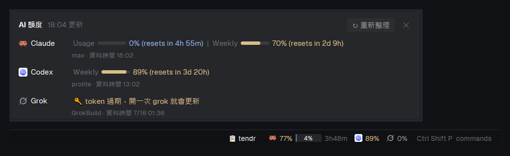

# herdr-quota

[English](README.en.md) ｜ 繁體中文

給 [herdr App](https://herdr.dev) 的 layout：底部狀態列右下角顯示 Claude、Codex、Grok、Antigravity 還剩多少額度。



- **週額度**：品牌 logo 後面直接寫百分比（70% 起變黃、90% 起變紅，快用完時加上幾天後重置）
- **5 小時額度**（Claude、Antigravity 有）：小進度條，百分比寫在條裡，後面是重置倒數（還沒用、0% 時不寫倒數）
- **Antigravity**（agy）的額度是分組的：圖示後面每組一段——`Gemini`（Gemini Flash／Pro）、`Opus`（Claude Opus、Sonnet、GPT-OSS）、`Argon`（Gemini 4 Argon，只有週額度）
- **點一下**：跳出詳細小視窗，每個額度的進度條、確切的重置時間、方案、資料時間，可以手動重新整理
- 有裝 [tendr](https://github.com/ailazytech/tendr) 的話，狀態列多一顆「📋 tendr」開關右側的 tendr 看板，App 開機後也會自動接回重開機前的 Claude 對話

## 安裝

需要：herdr App（裝好並開過一次）、Node.js 18 以上（在 PATH 上）、git。

```bash
git clone https://github.com/ailazytech/herdr-quota
node herdr-quota/install.mjs --switch
```

- 裝進 `~/.config/herdr-app`：`layouts/quota-main.json` 與 `mods/quota-status/`
- `--switch` 會檢查 mod 並切到 `quota-main`；`Ctrl+Shift+L` 可以切回原本的 layout
- 已經有 `quota-main.json` 的話不會蓋掉（你可能改過），要用新版加 `--force`，舊的會留備份
- 更新：`git pull` 後再跑一次 `node install.mjs`（mod 會更新，layout 照上一條）

### 搭配 tendr（選用）

layout 右側面板裡有一個 tendr 看板的位置。沒裝 tendr 時，安裝腳本會先把它拿掉；裝了 tendr 之後：

```bash
node tendr/app/install.mjs --layout quota-main
```

tendr 的安裝會把自己的位置寫進 `~/.tendr/install.json`，狀態列看到就會：

- 顯示「📋 tendr」開關右側看板
- App 開機後跑 tendr 的 `resume.mjs`，把重開機前的 Claude 對話接回來

## 資料從哪來

`mods/quota-status/quota.mjs` 讀各家 CLI 在本機的登入資訊，**token 只送到各自官方的用量 API**：

| | 讀哪裡 | 送到 |
| --- | --- | --- |
| Claude | `~/.claude/.credentials.json`（或 `CLAUDE_CONFIG_DIR`） | `api.anthropic.com/api/oauth/usage` |
| Codex | `~/.codex/sessions` 裡最近的 session 紀錄 | 不連網 |
| Grok | `~/.grok/auth.json` | `cli-chat-proxy.grok.com/v1/billing` |
| Antigravity | 不讀登入資訊：直接跑 `agy -p /usage --output-format json` | agy 自己查（不耗模型額度） |

- 結果快取在 `%LOCALAPPDATA%\herdr-quota\cache.json`（其他系統 `~/.cache/herdr-quota`）：Claude 5 分鐘（官方有限流）、Grok 2 分鐘、Antigravity 3 分鐘（每次要起一個 agy，約 5 秒）
- 沒裝 agy 的電腦不顯示 Antigravity；agy 給的是「剩多少」，這裡跟其他家一樣換成「用掉多少」
- **不會自己續期 token**（會搶掉 CLI 的登入）。token 過期時顯示 🔑，打開一次那個 CLI 就好
- Codex 每跑完一輪才更新額度；有些方案只有週額度
- 沒登入的服務顯示 🔑 或 ⚠️，不影響其他家

也可以在終端機直接看：

```bash
node ~/.config/herdr-app/mods/quota-status/quota.mjs line     # 一行
node ~/.config/herdr-app/mods/quota-status/quota.mjs detail   # 表格
```

## 設定

在 `~/.config/herdr-app/mods/quota-status/config.json`（沒有就自己建，更新不會蓋掉）：

```json
{ "providers": ["claude", "codex"], "warnAt": 85 }
```

| 設定 | 說明 | 預設 |
| --- | --- | --- |
| `providers` | 要顯示哪幾家，照順序 | `["claude", "codex", "grok", "agy"]` |
| `warnAt` | 幾 % 起變紅 | `90` |
| `ttlSec` | 各家的快取秒數 | `{ "claude": 300, "grok": 120, "agy": 180 }` |
| `timeoutMs` | 連線逾時 | `8000` |
| `agyTimeoutMs` | `agy -p /usage` 的逾時 | `30000` |

## 指令

`herdr-app do quota-status.<指令>`，或在 `keys.json` 綁 `quota-status:<指令>`：

- `detail`：開詳細小視窗
- `refresh`：不管快取，立刻重抓
- `tendr`：開關右側的 tendr 看板

## 移除

`Ctrl+Shift+L` 切回別的 layout，再刪掉 `~/.config/herdr-app/layouts/quota-main.json` 與 `~/.config/herdr-app/mods/quota-status/`。

## 給 agent

[RECIPE.md](RECIPE.md) 是照 herdr 慣例寫的重建說明：從空資料夾照著做，就能做出同樣的 layout 與 mod。

## 授權

[MIT](LICENSE)
