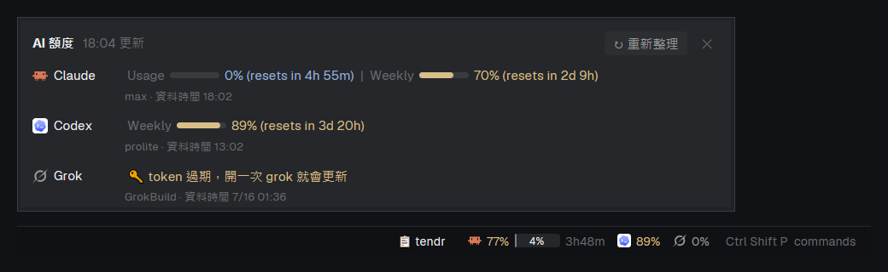

# Quota Main

Herdr's default window (spaces and agents on the left, tabs on top, pane cards, Files / Changes / tendr panels on the right) with one change: the bottom status bar shows how much of each AI coding plan is left. Claude, Codex and Grok each get their logo, the weekly limit as a plain percentage, and, where the plan has one, the 5-hour limit as a small bar with its percentage inside and the time until it resets. Clicking them opens a popup with every limit as a bar, its exact reset time, the plan name and how fresh the data is.

## What you see

- **Layout:** a clone of Herdr's `main` layout (app 0.1.10). Left sidebar 268 px (brand 46 px, spaces and agents lists, footer 69 px); work column with the tab bar (42 px), the active tab's panes as cards, an optional right panel 368 px (a stack of Files, Changes and tendr), and the status bar (28 px) at the bottom.
- **Status bar, left to right:** "This computer" (or the space's machine) with a monitor icon, the branch, "N agents" and "· N needs you" in the blocked color, a spacer, then on the right:
  - "📋 tendr", only when the layout has a block with id `tendr`: dim when the panel is hidden, foreground when it shows the tendr board.
  - One chip per provider, 12 px apart, in this order inside a chip (5 px gaps):
    1. The brand logo, 13 px: `icons/claude.svg` and `icons/codex.svg` drawn as full-color images, `icons/grok.svg` as a tinted svg (the app ships all three).
    2. The weekly (or monthly) limit as text, e.g. `77%`: muted below 70 %, the theme's `ansi3` (yellow) from 70 %, `ansi1` (red) from 90 %, when it also shows the reset, e.g. `92% 3d`. A window whose reset time has passed shows `✓`.
    3. The 5-hour limit (Claude only today) as a bar 44 × 13 px, radius 3, track `border`, fill in `ansi4` (or yellow / red as above) at opacity 0.65, the percentage centered on top in 10 px `foreground`, e.g. `4%`; then the countdown in `dim`, e.g. `3h48m`.
    4. A provider with no usable data shows its logo and `🔑` (token expired or not logged in: run that CLI once) or `⚠️` (anything else).
  - "Ctrl Shift P  commands" (⌘ on macOS), opening the palette.
- **Popup** (700 × 190, kind `popup`, at the pointer): header "AI 額度", the update time (date added when not today), a "↻ 重新整理" button and ✕. One row per provider: logo 15 px and name in an 84 px column, then each window as `Usage ▬ 4% (resets in 3h 50m) | Weekly ▬ 77% (resets in 2d 3h)` with 48 × 6 px bars; under it, in 11 px `dim`, the plan, "資料時間 hh:mm" when older than 2 minutes, and the error if the shown data is stale.

## How it behaves

- Data refreshes every 60 s. `quota.mjs` caches the network calls (Claude 5 min, the API's rate limit; Grok 2 min); Codex is read from local files every time.
- Clicking the chips opens the popup; ↻ forces a refresh past the cache. Both views share one `shared("quota-status.quota")` value, so either refresh updates both.
- Mod commands (`herdr-app do quota-status.<command>`, or `quota-status:<command>` in keys.json): `detail` opens the popup, `refresh` forces a refresh, `tendr` toggles the tendr panel.
- "📋 tendr" shows or hides the right panel on the tendr board (`layout.select {stack: "panel-body", child: "tendr"}`, `layout.show {id: "panel"}`). At start it adds `tendr` to the shared `workspace.panels`, so the shipped tab bar remembers the panel per space.
- If tendr is installed (`~/.tendr/install.json` exists), the bar also brings Claude Code back after a reboot: it runs tendr's `resume.mjs` at start and every minute for the first 10 minutes, and posts "已接回 N 個 Claude 對話" when it resumed something.
- Agent statuses (working, blocked, done, idle) are drawn by the shipped sidebar mods; the status bar only counts agents and blocked ones.

## Built from

- **Layout `quota-main`:** `row#root` → `column#sidebar` [`block#brand` workspace-chrome, `column#sidebar-lists` [`block#spaces` spaces, `block#agents` agents], `block#sidebar-footer` workspace-chrome `{footer: true}`] and `column#work` [`block#tabs` tabs, `row#work-body` [`block#main` content `{tab: "active"}` with pane header mod `pane`, `column#panel` [`stack#panel-body` [files, changes, `block#tendr` tendr-board]]], `block#status` quota-status].
- **Mod `quota-status`** (this repo): a copy of the shipped `workspace-status` plus the quota chips and popup. The same mod renders the popup when opened with `props().detail`. It uses `spaces`, `agents`, `theme`, `run`, `window`, `exec`, `shared`, `setShared`, `openOverlay`, `closeOverlay`, `nextCommand`, `props`, `layout`, `notify`, `home`, `appHome`, `readTextFile`.
- **Shipped mods:** workspace-chrome, spaces, agents, tabs, pane, files, changes. **Optional:** `tendr-board` from [ailazytech/tendr](https://github.com/ailazytech/tendr) (`app/`).
- **Programs:** `node` runs `mods/quota-status/quota.mjs json` (and tendr's `resume.mjs` when installed).
- **Network and files outside the mod folder:** `quota.mjs` reads `~/.claude/.credentials.json` (or `$CLAUDE_CONFIG_DIR`) and calls `https://api.anthropic.com/api/oauth/usage`; reads `~/.grok/auth.json` and calls `https://cli-chat-proxy.grok.com/v1/billing`; reads Codex's `~/.codex/sessions/**/rollout-*.jsonl` (no network). Each token goes only to its own provider. It caches results in `%LOCALAPPDATA%/herdr-quota/cache.json` (`~/.cache/herdr-quota` elsewhere).

## Watch out

- A popup's props come from `props()`; the `init` argument doesn't carry them.
- `herdr-app do <mod>.<command>` reaches shown copies only, and right after a layout switch the first command can be lost.
- Popups close on any click outside them, including the person working elsewhere in the window.
- Herdr's own layouts and mods are read-only (restored on every start): this is a clone, and so is the status mod.
- The Claude usage endpoint is rate limited: keep the 5-minute cache. `quota.mjs` never refreshes OAuth tokens (that would steal the CLI's login); an expired token shows 🔑 until the CLI runs again.
- Grok's billing response is protobuf JSON: fields that are 0 are omitted, so a current period without a percentage means 0 %.
- Codex only writes `rate_limits` at the end of a turn, and some plans have only a weekly window.
- The app's `exec` uses the person's PATH: `node` must be on it.

## Done when

- `herdr-app check ~/.config/herdr-app/mods/quota-status` passes and `herdr-app status` lists no errors after `layout.switch {name: "quota-main"}`.
- Within a minute the bar shows a logo and numbers for every provider the person is logged in to (🔑 or ⚠️ for the others).
- Clicking the chips opens the popup with one row per provider; ↻ changes the update time.
- `node ~/.config/herdr-app/mods/quota-status/quota.mjs json` prints an array of `{id, good, error}` entries.
- Without tendr's board installed there is no "📋 tendr" and no error.
